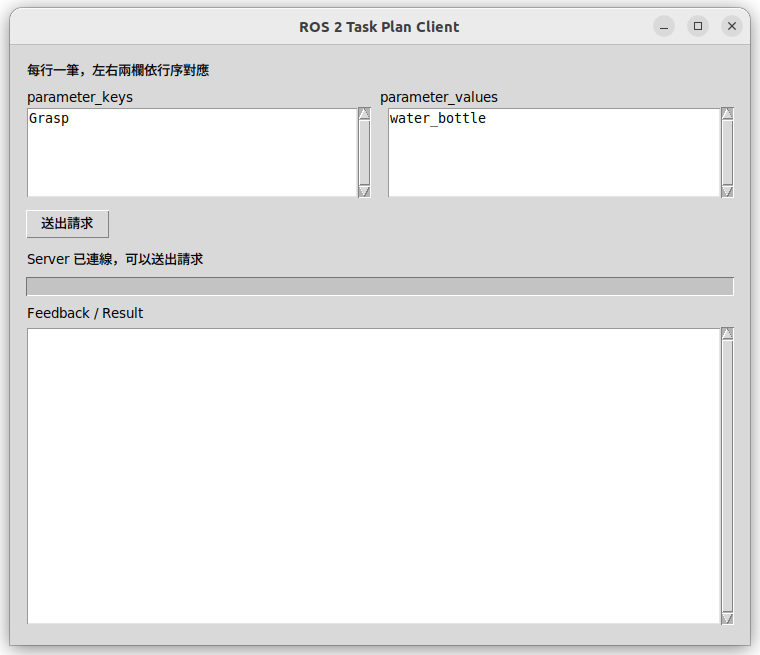
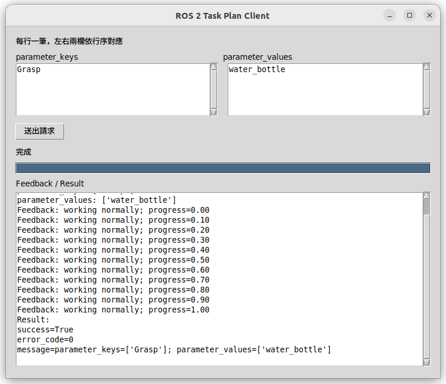

# ROS 2 ExecuteTaskPlan 範例

工作區：`~/ros2_task_plan_demo`，使用 ROS 2 Humble、Python 與 Tkinter。

功能：使用者分別填入兩個陣列，client 送出 Action 請求，server 回傳 Feedback 與最終 Result。
server 固定模擬執行約 5 秒，不會真的操作機器人。

### 1. 下載工作區
```bash
git clone https://github.com/owen-kdweng/ros2_task_plan_demo.git
```

### 2. 編譯
```bash
cd ~/ros2_task_plan_demo
colcon build
```

### 3. 啟動 server
Terminal 1
```bash
cd ~/ros2_task_plan_demo
source install/setup.bash
ros2 run task_plan_demo server
```

### 4. 啟動 client
Terminal 2
```bash
cd ~/ros2_task_plan_demo
source install/setup.bash
ros2 run task_plan_demo client_gui
```

### 4. 填入請求

在左欄 `parameter_keys` 輸入 `Grasp`，右欄 `parameter_values` 輸入 `water_bottle`。每行一筆，兩欄依行序對應，行數須相同。確認顯示「Server 已連線，可以送出請求」後，按「送出請求」。



送出後，Feedback 顯示 `status=working normally`，進度由 0 更新至 1。完成後可在下方看到 Result：`success=True`、`error_code=0`，以及 server 收到的兩個參數陣列。



### 程式位置
```text
src/interfaces/msg/Subtask.msg
src/interfaces/action/ExecuteTaskPlan.action
src/task_plan_demo/task_plan_demo/server.py
src/task_plan_demo/task_plan_demo/client_gui.py
```